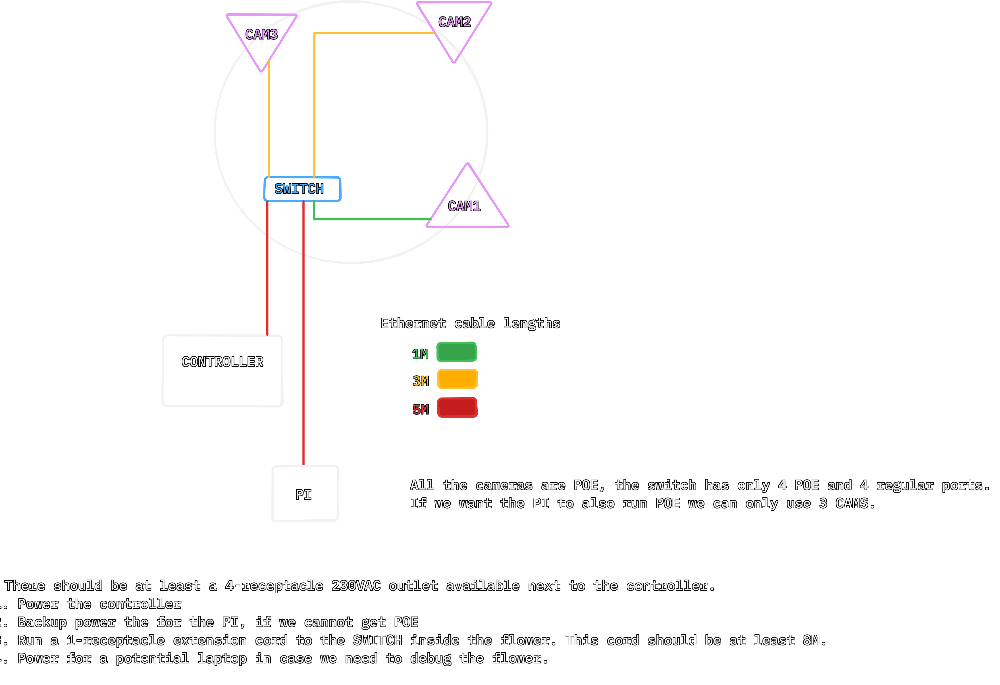

# Flower-Power
This repo contains packages and tooling for the Flower Power project, we can currently run this on a Linux based laptop or a Raspberry PI 4.

## Module Overview

- Processor: defines how to Flower should behave based on input data, this data is provided by the Image Harvester.

- Image Harvester: runs a [YOLO](https://docs.ultralytics.com/models/yolo26#overview) model, whichs draws boxes around the humans it detects. Those boxes are available to the Processor through a HTTP server.

- Core: this package contains the `FlowerAPI` and the `ImageHarvesterAPI`, it also has the `BoxesModel` which is used by the Processor and the ImageHarvester.

- Tools: various tools for debugging, mainly the `ping` tool.

- Mock Controller: a fake flower representation made by [@area42](https://github.com/area42) handy for development


### Commands


## Dependencies
- [uv](https://docs.astral.sh/uv/getting-started/installation/#installation-methods)
- [prek](https://prek.j178.dev/installation/) (dev)
- [ruff](https://docs.astral.sh/ruff/editors/setup/) (dev)
- [basedpyright](https://github.com/DetachHead/basedpyright) (dev)
- [just](https://just.systems/man/en/)


## Installation
1. Clone the repo and install its packages
```bash
git clone https://github.com/JopjeKnopje/Flower-Power
uv sync --all-packages
```

2. Make sure the config file values are correctly set, see [example](image-harvester.toml.example) config file.

3. Before running the image-harvester make sure that your machine can reach the cameras, see [reaching the cameras](#reaching-the-cameras).

4. Optionally you can setup crop the camera feeds running.
```bash
uv run image-harvester
```

5. Run the image-harvester, it should automatically connect to the cameras.
```bash
uv run cropper
```

## Cloning onto the PI
The PI wont have internet access, you can SSH into it with user `joppe` and passwd `123zegikniet`. We will ofc change this after the event hehe.


## Hardware
We are using a PoE Switch to power the cameras, the cameras don't actually have internet access with because they are running in a different subnet.

The cameras we're using are [AXIS P3364-VE](https://www.axis.com/dam/public/ee/0b/43/axis-p3364-ve--user-manual-en-US-113863.pdf) security cameras (without their creepy housing).

For the actual computer we've used RPI4, this is a [repo](https://github.com/JopjeKnopje/rpi-qemu) I've used to test some configuration stuff in QEMU. 


### Physical wiring



### Camera Addressing
The camera's are running on `192.168.0.X/24`, and are marked (see [photo](docs/cameras.jpg)) with a number representing the last digits of their IP address.

If you cannot reach the camera with their assigned address check if they're running on `192.168.0.90` which is their default address.

It's all in the `192.168.0.0/24` range, these addresses are static.
We connect to this network using a laptop, also configured with a static address.
We can bridge the laptop to a mobile hotspot or wifi network if we want proper internet connectivity.

> [!NOTE]
> Keep in mind that [`network-manager`](https://wiki.archlinux.org/title/NetworkManager) might try to "reclaim" your network interface after you've assigned a static ip to it. You can fix this by disabling it.

|Device|Addr|
|-|-|
|RPI   | 192.168.0.135 |
|CAM-1 | 192.168.0.1 |
|CAM-2 | 192.168.0.2 |
|CAM-3 | 192.168.0.3 |
|CAM-4 | 192.168.0.4 |
|FLOWER_ENDPOINT | 192.168.0.42 |

## Configure WAN less setup

Add a static ip to our interface so we can access the Flower subnet

### dev machine configuration
```bash
sudo ip link set enp0s31f6 down
sudo ip a add 192.168.0.10/24 dev enp0s31f6
sudo ip link set enp0s31f6 up
# there should be a route added, if thats not the case run.
sudo ip route add 192.168.0.0/24 dev enp0s31f6
```


### Setting up Flower Machine (DELL OPTIPLEX)
Install debian 12.2.0

```bash
su
apt update
apt install -y sudo vim git curl htop 

# add user to sudoers group
adduser joppe sudo
# relog

# install uv
curl -LsSf https://astral.sh/uv/install.sh | sh

git clone https://github.com/JopjeKnopje/Flower-Power.git
cd Flower-Power
```


#### Configuring network

https://wiki.debian.org/NetworkConfiguration#Configuring_the_network_on_Debian_systems

> /etc/network/interfaces

```txt
# This file describes the network interfaces available on your system
# and how to activate them. For more information, see interfaces(5).

source /etc/network/interfaces.d/*

# The loopback network interface
auto lo
iface lo inet loopback

# The primary network interface
allow-hotplug enp0s31f6
iface enp0s31f6 inet dhcp

iface enp0s31f6 inet static
address 192.168.0.135
netmask 255.255.255.0
gateway 192.168.0.1
```

## Troubleshooting
### Check if running cuda

```bash
uv run python -c "import torch; print(torch.cuda.is_available())"
```

### Camera unreachable
If for some reason the image-harvester won't connect to the camera(s)

Try seeing if they are reachable, I've made a tool which will ping the cameras defined in the config file.
You can run it with.
```bash
uv run ping-test
```

### Using DHCP server to reach the PI in-case of static ip issues
```bash
sysctl net.ipv4.ip_unprivileged_port_start=67
apt install dns masq
```

in its config `/etc/dnsmasq.conf` set `port=0` to disable its DNS functionality.

Monitor its logs with
```bash
journalctl --follow -u dnsmasq
```

### Bad camera focus
You can usually get around this by playing around with the zoom in the webUI, the focus will adjust automatically with it.


### Resetting the camera
Checkout the manual
Press the small recessed button on the camera for about 15s until the lights start flickering, you should then be able to reach it at `192.168.0.90`.

1. Set the powerline frequency to 50Hz
2. Set the password to `admin`


### Setting up dockerfile
NOTE: None of these graphical libraries should be needed if we don't use CUDA.

```bash
#install libxcb
apt-get install libxcb-randr0-dev libxcb-xtest0-dev libxcb-xinerama0-dev libxcb-shape0-dev libxcb-xkb-dev
# install libgl
apt-get install ffmpeg libsm6 libxext6  -y


# push it to the registery
d push pojpe/image_harvester:latest
```


## Todo V2

- [ ] Fix cropping not working with more than 1 camera.
- [ ] Fix for more than 1 cam cropping didn't seem to work
- [ ] Add zones, if people in zone we handle them (this can be done with cropping and disabling specific cameras)

- [ ] Just file to push calibration files to PI
- [ ] Fix crash when connection error (flower offline or incorrect page)
- [ ] Fix fonts
- [ ] The cropper should be `VideoSource` agnostic, it currently only works for `VideoSourceRTP`.
- [ ] Crop images to remove sky, join images together to optimize space.
- [ ] Don't die when camara disconnects
- [ ] Use optimized model format for PI / edge devices
- [ ] Stream/log datapoints
- [ ] Remote video feed
- [ ] Flower animation
- [ ] NOTE: Flower pos is 0-9
- [ ] Add endpoint to ping test
- [ ] Setup/preview mode, run the GUI without any api calls or processing
- [ ] Run simple server on the RPI which logs the data both pre and post processed from the flower.
- [ ] Add seek to video playback
- [ ] Think about design pattern so we can inject behaviour in our loop regarding running headless.
- [ ] Add `cam_id` to config file, also check that there are no duplicates
- [ ] Add support to the `Config` for using linux video devices indentified by a number e.g `cv2.VideoCapture(0)`
- [ ] Ping tool also pings flower endpoint lol
- [ ] Tweak model (set minimum confidence score threshold in config file?)
- [ ] Send out a status check to the hydraulic controller at the same time it connects with the cameras to make sure its online
- [ ] Set it up on a RPI (ansible? or some other iac tool) and write setup instructions for that.
- [ ] Container to keep track of all the file recording stuff, such as the filepath.
- [ ] Script to do initial setup of the cameras.
- [ ] Add threading while connecting to the cameras.
- [ ] Benchmark yolo runs and image stitching parts of the program
- [ ] fix hconcat
- [ ] Wait for all cameras in feed to come online with a set timeout, also when camera goes offline log it. But keep going
- [ ] Check the camera resolution
- [ ] Increase yolo resolution?
- [ ] Do 2 builds/modes?, one for x86_64 and the other for ARM64
- [ ] `value = math.tanh(1 * math.pi / 2)  * 10`

## Weird nvidia fix
`torch==2.11.0` adds a bunch of nvidia packages, even when running on aarch64 (which doesn't hava GPU lol)
I "fixed" this by running `torch==2.6.0`. I still have to figure out why this is being added
When running `2.11.0` we get illegal instruction, probablyt because it calls to an nvidia cuda binary which we cannot execute ofc.
Lets `strace` that


When we strace `2.11.0` we can see its looking for 
```bash
openat(AT_FDCWD, "/home/pi/rpi-object-detection/venv/lib/python3.13/site-packages/torch/lib/../../nvidia/cudnn/lib/libcuda.so.1", O_RDONLY|O_CLOEXEC) = -1 ENOENT (No such file or directory)
openat(AT_FDCWD, "/home/pi/rpi-object-detection/venv/lib/python3.13/site-packages/torch/lib/../../nvidia/nvshmem/lib/libcuda.so.1", O_RDONLY|O_CLOEXEC) = -1 ENOENT (No such file or directory)
openat(AT_FDCWD, "/home/pi/rpi-object-detection/venv/lib/python3.13/site-packages/torch/lib/../../nvidia/nccl/lib/libcuda.so.1", O_RDONLY|O_CLOEXEC) = -1 ENOENT (No such file or directory)
openat(AT_FDCWD, "/home/pi/rpi-object-detection/venv/lib/python3.13/site-packages/torch/lib/../../nvidia/cusparselt/lib/libcuda.so.1", O_RDONLY|O_CLOEXEC) = -1 ENOENT (No such file or directory)
openat(AT_FDCWD, "/home/pi/rpi-object-detection/venv/lib/python3.13/site-packages/torch/lib/../../nvidia/cu13/lib/libcuda.so.1", O_RDONLY|O_CLOEXEC) = -1 ENOENT (No such file or directory)
openat(AT_FDCWD, "/home/pi/rpi-object-detection/venv/lib/python3.13/site-packages/torch/lib/libcuda.so.1", O_RDONLY|O_CLOEXEC) = -1 ENOENT (No such file or dir
```


When we strace `2.6.0`, `libcuda` is not even mentioned

2.9 also works

## Resources
- [pyproject.toml - dependency version syntax](https://stackoverflow.com/questions/54720072/dependency-version-syntax-for-python-poetry)
- [pyproject.toml - environment markers](https://packaging.python.org/en/latest/specifications/dependency-specifiers/)
- [yolo - python docx](https://docs.ultralytics.com/usage/python)
- [what are tensors](https://medium.com/@payalparida_datascientist/why-tensors-are-essential-in-ml-dl-3fdd12365bca)
- [uv project structure](https://stackoverflow.com/a/79817200/7363348)
- [python logging cookbook](https://docs.python.org/3/howto/logging-cookbook.html)
- [python forward declaration __future__](https://stackoverflow.com/a/55344418/7363348)
- [python protocols](https://andrewbrookins.com/technology/building-implicit-interfaces-in-python-with-protocol-classes/)

## Credits
- [bufferless-video-capture](https://stackoverflow.com/a/54755738/7363348)
- [colored logging python](https://stackoverflow.com/a/56944256/7363348)
